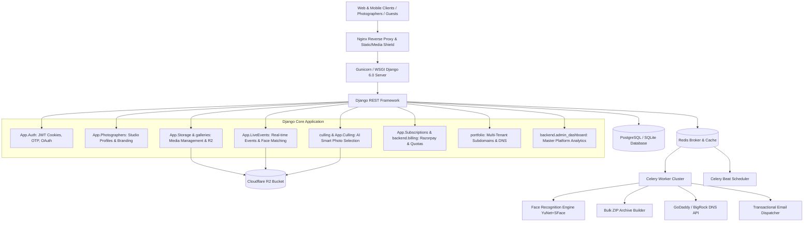

# EX SHARE (Photography Project) - Complete Architecture & Project Structure

> **Production Backend:** Django REST Framework, Celery, Redis, PostgreSQL / SQLite  
> **Storage & Delivery:** Cloudflare R2 Object Storage (S3-compatible) & Cloudflare CDN  
> **Computer Vision:** YuNet + SFace Biometric Face Recognition, NudeNet Moderation  
> **Payment & DNS:** Razorpay Gateway, GoDaddy / BigRock Subdomain Automation  

---

## 1. High-Level System Architecture



---

## 2. Directory & File Structure

```
photography-project-djangorest/
├── config/                          # Project configuration root
│   ├── __init__.py
│   ├── asgi.py                      # ASGI entrypoint
│   ├── wsgi.py                      # WSGI entrypoint for Gunicorn/production
│   ├── celery.py                    # Celery application & task autodiscovery
│   ├── settings.py                  # Django global settings, R2 storages, JWT, caches
│   └── urls.py                      # Global URL router & media recovery handler
│
├── App/                             # Core modular application suite
│   ├── __init__.py
│   ├── apps.py                      # App configuration, SQLite pragmas & face engine check
│   ├── urls.py                      # Master App routing aggregator
│   ├── face_engine.py               # YuNet face detector & SFace embedding extraction
│   │
│   ├── Auth/                        # Authentication & Identity domain
│   │   ├── auth_backend.py          # Multi-identifier backend (Username, Email, Phone)
│   │   ├── auth_emails.py           # Authentication emails (OTP, password reset, welcome)
│   │   ├── auth_models.py           # User, RegistrationOTP, PasswordlessLoginOTP models
│   │   ├── auth_serializers.py      # Registration, Login, Token, OTP serializers
│   │   ├── auth_throttling.py       # LoginRateThrottle (10 req/min credential brute-force protection)
│   │   ├── auth_urls.py             # Login, register, OTP verification, Google OAuth routes
│   │   ├── auth_utils.py            # CookieJWTAuthentication (access & refresh tokens in HTTP-only cookies)
│   │   └── auth_views.py            # LoginView, GoogleAuthView, PasswordlessOTP views
│   │
│   ├── Photographers/               # Studio & Photographer management
│   │   ├── photo_admins.py          # Django admin configuration
│   │   ├── photo_emails.py          # Studio booking inquiry notifications
│   │   ├── photo_models.py          # PhotographerProfile, Notification, Watermark config
│   │   ├── photo_serializers.py     # Profile, Studio Settings, Watermark serializers
│   │   ├── photo_urls.py            # Onboarding, profile update, watermark upload endpoints
│   │   ├── photo_utils.py           # NudeNet image safety check & validation
│   │   ├── photo_views.py           # PhotographerProfileView, OnboardingView
│   │   └── test_*.py                # Watermark, onboarding, and moderation test suites
│   │
│   ├── Storage/                     # Enterprise Media & Gallery Storage Engine
│   │   ├── storage_models.py        # Gallery, Media, GallerySection, BulkDownloadJob, StoryVideo
│   │   ├── storage_serializers.py   # PublicGallerySerializer, MediaSerializer, BulkDownloadJobSerializer
│   │   ├── storage_urls.py          # Galleries CRUD, upload, reorder, and download routes
│   │   ├── storage_views.py         # StandardMediaUploadView, SharedGalleryView, FaceSearchView
│   │   ├── resumable_views.py       # Resumable chunked upload endpoints (init, chunk, complete, cancel)
│   │   ├── tasks.py                 # Async thumbnail generation, face indexing, bulk ZIP bundling
│   │   ├── throttling.py            # Storage throttle definitions
│   │   └── services/                # Decoupled core storage services
│   │       ├── storage_service.py   # CloudflareR2StorageProvider & CloudflareR2Storage backend
│   │       ├── media_transfer.py    # Zero-loss file byte streaming and gallery migration
│   │       ├── face_service.py      # Face search query execution and cosine similarity ranking
│   │       ├── quota_service.py     # Photographer cloud storage limit validation
│   │       ├── watermark_service.py # Dynamic text & logo image watermark stamping
│   │       └── resumable_upload_service.py # Chunked file assembler & checksum verifier
│   │
│   ├── LiveEvents/                  # Real-Time Event Streaming & Instant Face Matching
│   │   ├── event_models.py          # LiveEvent, EventMedia, EventFaceEmbedding
│   │   ├── event_serializers.py     # PublicEventPortalSerializer, EventMediaSerializer
│   │   ├── event_tasks.py           # Async face indexing from event photo uploads
│   │   ├── event_urls.py            # Live events endpoints, QR portal, attendee selfie match
│   │   └── event_views.py           # PublicEventDetailView, EventFaceSearchView
│   │
│   ├── Culling/                     # Legacy/Sub-package culling components
│   │   ├── culling_models.py        # CullingSession, CullingItem, CullingClusterGroup
│   │   ├── culling_urls.py          # Direct culling routes
│   │   └── culling_views.py         # Staging uploads & cull execution
│   │
│   ├── Subscriptions/               # SaaS Plans & Razorpay Payment Integration
│   │   ├── sub_models.py            # Plan, PhotographerSubscription, SubscriptionPayment
│   │   ├── sub_serializers.py       # PlanSerializer, SubscriptionDetailSerializer
│   │   ├── sub_services.py          # Quota allocator, subscription lifecycles
│   │   ├── sub_enforcer.py          # Middleware/guard enforcing active studio plans
│   │   ├── sub_urls.py              # Checkout, verification, webhook endpoints
│   │   ├── sub_views.py             # PlanListView, SubscriptionStatusView
│   │   ├── views_razorpay.py        # Razorpay order generation & signature validation
│   │   └── tasks.py                 # Scheduled subscription expiry checks
│   │
│   ├── Notifications/               # Notification routing & event hooks
│   └── management/commands/         # Custom operational CLI tools
│       ├── reconcile_storage_usage.py   # Re-calculates actual storage bytes against DB
│       ├── reindex_faces.py             # Re-extracts facial embeddings across existing collections
│       ├── repair_server_gallery_media.py # Self-heals missing media paths & storage keys
│       ├── purge_expired_trash_events.py # Cleans expired temporary archives
│       └── seed_plans.py                # Populates default subscription tiers
│
├── galleries/                       # Public & Client Gallery Features
│   ├── models.py                    # Compatibility bindings to App.Storage models
│   ├── serializers.py               # Client gallery serializers
│   ├── urls.py                      # Gallery download and viewer routes
│   ├── views_upload.py              # BulkMediaUploadService & BulkUploadGalleryMediaView
│   ├── bulk_favorite.py             # Batch favoriting logic
│   └── views/
│       ├── bulk_favorite.py         # BulkToggleMediaFavoriteView
│       ├── gallery_zip_download.py  # GalleryZipDownloadView (high-speed ZIP streaming)
│       ├── media_download.py        # MediaDownloadView (watermarked/raw downloads)
│       └── viewer_likes.py          # Viewer authentication, liked media, and OTPs
│
├── gallery/                         # Gallery Reordering & Story Videos
│   ├── models.py                    # Reorder tracking & story video models
│   ├── serializers.py               # Story video serializers
│   ├── urls.py                      # Reordering & story video endpoints
│   ├── views.py                     # GalleryViewSet, GalleryStoryVideoListCreateView
│   └── services/reorder.py          # Reordering algorithm for custom photo sequences
│
├── culling/                         # AI-Powered Smart Photo Culling
│   ├── ai_engine.py                 # Focus sharpness scoring, burst sequence grouping
│   ├── models.py                    # CullingSession, CullingPhoto models
│   ├── permissions.py               # HasAICullingAccess, HasAICullingPlanPermission
│   ├── serializers.py               # Session & Photo serializers
│   ├── tasks.py                     # Async AI analysis task execution
│   ├── urls.py                      # Staging upload & AI trigger routes
│   ├── views.py                     # UploadCullingPhotosView, TriggerAIAnalysisView
│   └── services/
│       ├── culling_engine.py        # Laplacian variance & image sharpness computation
│       ├── gallery_bridge.py        # Moves culled selections into permanent client galleries
│       └── payment_service.py       # Culling session checkout & unlocking
│
├── portfolio/ & portfolios/         # Multi-Tenant Portfolio CMS & Subdomain Engine
│   ├── models.py                    # PortfolioConfig, PortfolioWork, PortfolioInquiry, PortfolioView
│   ├── serializers.py               # Portfolio details, client inquiries, template configuration
│   ├── tenant_resolver.py           # Dynamically resolves studio profile from HTTP `Host` header
│   ├── subdomain_service.py         # Subdomain availability & syntax validation
│   ├── godaddy_service.py           # GoDaddy REST API for automated DNS CNAME record creation
│   ├── bigrock_service.py           # BigRock DNS API automation
│   ├── tasks.py                     # Celery task for async DNS provisioning
│   ├── urls.py                      # Portfolio management & public tenant routes
│   ├── views.py                     # PublicPortfolioDetailView, ProjectManagementView
│   ├── views_public_tenant.py       # PublicTenantPortfolioView, PublicTenantTrackView
│   └── views_subdomain.py           # SubdomainAvailabilityView, SubdomainClaimView
│
├── inquiries/                       # Centralized Client Inquiries & Leads CRM
│   ├── models.py                    # Inquiry model (client details, wedding/event dates, notes)
│   ├── serializers.py               # PublicInquirySubmissionSerializer, InquiryDetailSerializer
│   ├── urls.py                      # Public submission & studio inquiry list routes
│   └── views.py                     # PublicInquirySubmitView, InquiryListView
│
├── backend/                         # Administrative & Extended Services
│   ├── admin_dashboard/             # Master Platform Dashboard for site administrators
│   │   ├── pagination.py            # Admin table pagination
│   │   ├── permissions.py           # Superuser & staff access controls
│   │   ├── serializers.py           # Revenue, storage, and photographer metrics
│   │   ├── urls.py                  # Admin dashboard endpoints
│   │   └── views.py                 # AdminStatsOverviewView, ManagePhotographersView
│   ├── atelier_plans/               # Atelier Studio membership enforcement
│   └── billing/                     # Studio checkout and billing histories
│
├── utils/                           # Shared utility helpers
│   ├── exshare_uploader.js          # Production browser JavaScript uploader (chunks + direct R2)
│   └── watermark.py                 # PIL-based watermark processor
│
├── templates/                       # HTML templates
│   ├── profile_preview.html         # Studio profile preview
│   └── unfold/helpers/userlinks.html# Django Unfold modern admin theme customization
│
├── requirements.txt                 # Pinned Python package dependencies
├── manage.py                        # Django management script
├── nginx_exshare_optimized.conf     # Production Nginx reverse proxy configuration
├── nginx_portfolio_wildcard.conf    # Wildcard Subdomain Nginx routing configuration
├── .env                             # Environment secrets & active configuration (gitignored)
└── .env.example                     # Environment template with dummy variables
```

---

## 3. Core Functional Domains & Modules

### 3.1 Authentication & Security (`App/Auth`)
* **Multi-Identifier Login:** Authenticate using email, phone number, or username (`UsernameEmailPhoneBackend`).
* **Session Storage:** Issues standard JWT tokens via HTTP-only, secure cookies (`access_token`, `refresh_token`), avoiding browser localStorage security vulnerabilities.
* **Rate Limiting:** Protects the login endpoint against brute-force attacks (`LoginRateThrottle` = 10 requests/minute).
* **Passwordless OTP:** Enables one-time password logins and email/phone verification.
* **Social Auth:** Google OAuth2 token validation.

### 3.2 Media Storage & Cloudflare R2 Integration (`App/Storage`, `galleries`)
* **Storage Provider:** High-performance adapter for **Cloudflare R2** using `boto3` (`CloudflareR2StorageProvider` & `CloudflareR2Storage`).
* **Storage Path Isolation:** `galleries/<gallery_id>/originals/<media_id>_<filename>` (supporting up to 512 characters in PostgreSQL).
* **Delivery & CDN:** Media URLs delivered via Cloudflare public dev domain or custom CDN domain (`R2_PUBLIC_DOMAIN`). If unconfigured, falls back to secure 24-hour presigned S3 URLs.
* **Upload Mechanisms:**
  1. *Standard Multipart Batch Upload:* High-volume parallel uploads with zero-RAM disk streaming.
  2. *Resumable Chunked Uploads:* Deduplicated via SHA-256 with pause, resume, and integrity verification.
  3. *Direct-to-R2 Uploads:* Generates short-lived presigned `PUT` URLs allowing browsers to upload directly to R2.
* **Derivatives Generation:** Asynchronously creates Lanczos WebP previews (1600px) and thumbnails (400px) via Celery.
* **Bulk Download Engine:** Asynchronously bundles selected/all gallery photos into ZIP archives using Celery with Nginx `X-Accel-Redirect` acceleration.

### 3.3 Biometric Face Recognition & Live Events (`App/LiveEvents`, `App/face_engine.py`)
* **Face Detector:** Lightweight OpenCV **YuNet** detecting faces across varied lighting and angles.
* **Face Embedder:** OpenCV **SFace** generating 128-dimensional biometric embeddings stored in `EventFaceEmbedding`.
* **Guest Flow:**
  1. Attendees scan an event QR code to open the mobile guest portal.
  2. Attendee snaps a selfie.
  3. Cosine similarity compares the selfie vector against the event's pre-computed embeddings.
  4. Returns **only** photos containing that attendee in sub-second response times.

### 3.4 AI Smart Photo Culling (`culling`)
* **Automated Culling Engine:** Computes Laplacian variance sharpness metrics and groups burst sequences.
* **Staging Pipeline:** Photos uploaded to isolated staging buckets; upon culling completion, chosen photos are moved to the target gallery via `transfer_media_to_gallery()` without re-downloading.
* **Commercial Model:** Supports free quota per subscription tier or pay-per-cull Razorpay unlocks.

### 3.5 Multi-Tenant Portfolios & Custom Subdomains (`portfolio`)
* **Tenant Resolution:** `tenant_resolver.py` inspects the incoming HTTP `Host` header (e.g. `studio.exshare.ai`) and dynamically resolves the photographer's portfolio showcase.
* **Automated DNS Provisioning:** Integration with **GoDaddy** and **BigRock** APIs to automatically register and verify `CNAME` records upon subdomain claim.
* **Portfolio Showcase:** Public display of photographer portfolio works, categorized photo albums, bio, inquiry forms, and WhatsApp direct contact buttons.

### 3.6 Subscriptions & Quota Enforcement (`App/Subscriptions`, `backend/billing`)
* **Tiered Membership:** Tier-based quotas for total storage capacity, active live events, and AI culling photos.
* **Razorpay Gateway:** Server-side order creation (`PlanCheckoutView`) and webhook verification (`PlanVerifyView`).
* **Expiry Protection:** Automatically locks public gallery viewing and downloads if a studio's subscription lapses, directing visitors to a courteous renewal notice.

---

## 4. Key Database Models

| Model | App | Description |
|---|---|---|
| `User` | `App.Auth` | Custom user model with roles (`photographer`, `client`, `admin`), phone, and unique UUID |
| `PhotographerProfile` | `App.Photographers` | Studio branding, bio, watermark settings, storage usage counter |
| `Gallery` | `App.Storage` | Photo collection with layout template, password, expiration date, share token |
| `Media` | `App.Storage` | Original image/video record with storage keys, dimensions, WebP derivatives, and sort orders |
| `GallerySection` | `App.Storage` | Named album dividers within a gallery (e.g. "Highlights", "Ceremony", "Reception") |
| `BulkDownloadJob` | `App.Storage` | Asynchronous ZIP compilation state tracking and download URL |
| `LiveEvent` | `App.LiveEvents` | Real-time event entity with guest access QR code and view counters |
| `EventMedia` | `App.LiveEvents` | Media file uploaded to a live event |
| `EventFaceEmbedding` | `App.LiveEvents` | 128-float vector representing an individual face in an event photo |
| `CullingSession` | `culling` | AI photo selection workspace with status, photo count, and payment state |
| `PortfolioConfig` | `portfolio` | Portfolio showcase settings, claimed subdomain, accent colors, social links |
| `PortfolioInquiry` | `portfolio` | Prospective client booking lead with date, message, and contact details |
| `Plan` | `App.Subscriptions` | Subscription tier (Storage limits, event limits, AI quota, pricing) |
| `PhotographerSubscription`| `App.Subscriptions` | Active subscription record, renewal date, and payment status |

---

## 5. Master API Route Hierarchy

| Endpoint Base | App / Module | Primary Purpose |
|---|---|---|
| `/api/token/` | `backend.admin_dashboard` | Master administrator JWT login |
| `/api/auth/` | `App.Auth` | Registration, login, passwordless OTP, Google OAuth |
| `/api/photographers/` | `App.Photographers` | Studio profiles, watermark uploads, onboarding |
| `/api/storage/galleries/` | `App.Storage` | Gallery creation, batch uploads, reordering, settings |
| `/api/storage/uploads/` | `App.Storage` | Chunked resumable upload engine (init, chunk, complete) |
| `/api/public/galleries/` | `App.Storage` & `galleries`| Public guest gallery view, PIN check, ZIP downloads |
| `/api/events/` | `App.LiveEvents` | Live event management, QR codes, selfie face discovery |
| `/api/culling/` | `culling` | Staging photo uploads, AI sharpness analysis, cull approval |
| `/api/portfolio/` | `portfolio` | Portfolio CMS settings, projects, subdomain claim |
| `/api/public/portfolio-site/` | `portfolio` | Multi-tenant public portfolio viewer by domain |
| `/api/public/inquiries/` | `inquiries` | Public lead generation form submissions |
| `/api/plans/` & `/api/billing/` | `App.Subscriptions` | Studio plan selection, Razorpay order checkout & verification |
| `/api/admin/dashboard/` | `backend.admin_dashboard`| Platform-wide statistics, user lists, revenue analytics |

---

## 6. Background Asynchronous Processing (Celery & Redis)

* **`process_media_derivatives_and_faces_task`** (`App.Storage.tasks`):
  Generates 1600px preview WebP, 400px thumbnail WebP, and triggers facial recognition indexing without blocking HTTP responses.
* **`generate_bulk_download_archive_task`** (`App.Storage.tasks`):
  Fetches files from R2/disk, compiles compressed ZIP archives, and delivers download links via email/socket.
* **`process_face_embeddings_task`** (`App.LiveEvents.event_tasks`):
  Extracts 128D face vectors from event uploads and indexes them in `EventFaceEmbedding`.
* **`provision_subdomain_dns_task`** (`portfolio.tasks`):
  Calls GoDaddy / BigRock DNS APIs asynchronously to attach new subdomains without HTTP latency.
* **`run_server_side_culling`** (`culling.tasks`):
  Runs multithreaded focus sharpness and burst group clustering over large photo batches.
* **`send_passwordless_otp_email`** (`App.Auth.auth_emails`):
  Sends transactional verification emails asynchronously.

---

## 7. Environment Variables Reference (`.env`)

```ini
# Application Core
SECRET_KEY=your-secure-django-secret-key
DEBUG=False
ALLOWED_HOSTS=*

# Database (PostgreSQL Production / SQLite Development)
DB_NAME=photography_db
DB_USER=postgres
DB_PASSWORD=your_password
DB_HOST=127.0.0.1
DB_PORT=5432

# Redis & Celery
CELERY_BROKER_URL=redis://127.0.0.1:6379/0
CELERY_RESULT_BACKEND=redis://127.0.0.1:6379/0

# Cloudflare R2 Media Storage
STORAGE_PROVIDER=r2
R2_ACCOUNT_ID=231b582c4700866390a38c6fdfac20b8
R2_ACCESS_KEY_ID=your_access_key_id
R2_SECRET_ACCESS_KEY=your_secret_access_key
R2_BUCKET_NAME=exshareai
R2_ENDPOINT_URL=https://231b582c4700866390a38c6fdfac20b8.r2.cloudflarestorage.com
R2_PUBLIC_DOMAIN=https://pub-40b29470f4d940d6b7ab2eab1595bfd9.r2.dev

# Subdomain & Custom Domains
PORTFOLIO_DOMAIN=exshare.ai
PORTFOLIO_SERVER_IP=31.97.232.245
GODADDY_API_KEY=your_godaddy_key
GODADDY_API_SECRET=your_godaddy_secret

# Payments (Razorpay)
RAZORPAY_KEY_ID=rzp_live_xxxx
RAZORPAY_KEY_SECRET=your_razorpay_secret

# Email Dispatch
EMAIL_HOST=smtp.gmail.com
EMAIL_PORT=587
EMAIL_USE_TLS=True
EMAIL_HOST_USER=noreply@exshare.ai
EMAIL_HOST_PASSWORD=your_app_password
```
